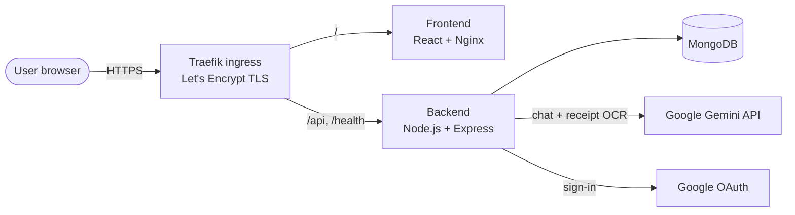
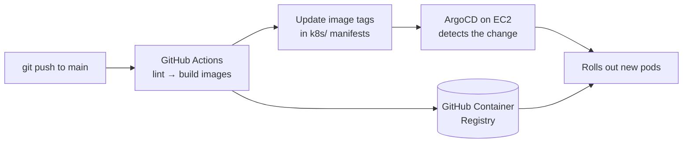

<div align="center">

# 💰 Expense Tracker

**A full-stack personal finance app with AI insights, receipt scanning and group bill splitting.**

[](https://sahil-expense-tracker.duckdns.org)
[](LICENSE)
[](https://github.com/sahilgupta630/Expense-Tracker/actions)


[Live Demo](https://sahil-expense-tracker.duckdns.org) · [Features](#-features) · [Quick Start](#-quick-start) · [API](#-api-reference) · [Deployment](#-deployment)

</div>

---

## 📖 Overview

Expense Tracker helps you understand where your money goes. Log expenses in seconds, or snap a photo of a receipt and let AI fill in the details. Set savings goals and spending limits, split bills with friends, and ask the built-in AI assistant questions about your own spending.

It is a production-style MERN application: containerised, deployed on Kubernetes with automatic HTTPS, and shipped through a GitOps CI/CD pipeline on every push to `main`.

## ✨ Features

| | Feature | Description |
|---|---|---|
| 📊 | **Dashboard** | Totals, annual spending trend, category breakdown, payment-method insights and recent transactions |
| 🧾 | **Expense management** | Add, edit, delete and filter expenses with categories and payment methods |
| 📷 | **AI receipt scanner** | Upload a receipt photo and Gemini Vision fills in the amount, description, date, category and payment method |
| 🤖 | **AI finance assistant** | Chat with an assistant that reads *your* expense data and answers questions, spots trends and suggests budgets |
| 🎯 | **Budget goals** | Savings goals with contributions and progress tracking, plus category spending limits |
| 👥 | **Group bill splitting** | Create groups, invite friends with a code, split bills between multiple payers |
| 🤝 | **Smart settle-up** | Calculates the minimum number of payments needed to settle a bill |
| 🔔 | **Notifications** | In-app alerts for new expenses, new group bills and settled bills |
| 🔐 | **Authentication** | Email/password with JWT, plus optional Google sign-in (OAuth 2.0) |
| 🛡️ | **Admin panel** | User management (roles, activation), activity monitoring and live system health |

## 🏗️ Architecture



**Request flow:** the React app stores a JWT after login and sends it as `Authorization: Bearer <token>` on every API call. The backend verifies the token, loads the user, and checks that the user owns (or is a group member of) the data being requested before touching MongoDB.

## 🧰 Tech Stack

| Layer | Technologies |
|---|---|
| **Frontend** | React 18, Vite 6, Tailwind CSS 4, React Router 7, Recharts, Axios, Lucide icons |
| **Backend** | Node.js 20, Express 4, Mongoose 8, JWT, bcrypt, Passport (Google OAuth 2.0), express-session |
| **AI** | Google Gemini 2.5 Flash (chat assistant and receipt OCR) |
| **Database** | MongoDB 7 |
| **DevOps** | Docker, k3s (Kubernetes), Traefik, cert-manager, ArgoCD, GitHub Actions, GitHub Container Registry |

## 🚀 Quick Start

### Prerequisites

- [Node.js](https://nodejs.org) 20 or newer
- MongoDB: [Docker Desktop](https://www.docker.com/products/docker-desktop/) (easiest) or a free [MongoDB Atlas](https://www.mongodb.com/atlas) cluster
- A free [Gemini API key](https://aistudio.google.com/apikey) for the AI features

### Option 1: Run with npm (best for development)

```bash
# 1. Clone
git clone https://github.com/sahilgupta630/Expense-Tracker.git
cd Expense-Tracker

# 2. Start MongoDB (skip if you use Atlas)
docker run -d --name expense-tracker-mongo -p 27017:27017 -v expense-tracker-mongo-data:/data/db mongo:7.0

# 3. Backend: http://localhost:5000
cd backend
cp .env.example .env        # then fill in your values (see below)
npm install
npm run dev

# 4. Frontend: http://localhost:5173 (in a second terminal)
cd frontend
cp .env.example .env
npm install
npm run dev
```

### Option 2: Run everything with Docker Compose

```bash
cp backend/.env.example backend/.env   # fill in GEMINI_API_KEY, JWT_SECRET, SESSION_SECRET
docker compose up --build
```

Open **http://localhost**. The API runs on `http://localhost:5000`.

### First login

On first start the backend creates an admin account:

| Email | Password |
|---|---|
| `admin@expensetracker.com` | `admin123` |

> ⚠️ Change this password immediately on any server that is reachable from the internet.

## ⚙️ Configuration

### `backend/.env`

| Variable | Required | Description |
|---|:---:|---|
| `PORT` | ✅ | API port, normally `5000` |
| `mongoDBURL` | ✅ | MongoDB connection string, e.g. `mongodb://localhost:27017/expense-tracker` |
| `JWT_SECRET` | ✅ | Long random string used to sign login tokens |
| `SESSION_SECRET` | ✅ | Long random string used to sign session cookies |
| `FRONTEND_URL` | ✅ | Where the frontend runs (used for CORS and redirects), e.g. `http://localhost:5173` |
| `BACKEND_URL` | ✅ | Public base URL of the backend **without** `/api`, e.g. `http://localhost:5000` |
| `GEMINI_API_KEY` | ✅ | Enables the AI assistant and receipt scanner |
| `GOOGLE_CLIENT_ID` | ➖ | Google OAuth client ID. Google sign-in is disabled if empty |
| `GOOGLE_CLIENT_SECRET` | ➖ | Google OAuth client secret |

Generate secrets with `openssl rand -hex 32`, or with `node -e "console.log(require('crypto').randomBytes(32).toString('hex'))"`.

### `frontend/.env`

| Variable | Description |
|---|---|
| `VITE_BACKEND_URL` | Backend API base URL **including** `/api`, e.g. `http://localhost:5000/api` |

### Google sign-in (optional)

1. In [Google Cloud Console](https://console.cloud.google.com/apis/credentials), create an **OAuth client ID** (type: Web application).
2. Add these authorised redirect URIs:
   - `http://localhost:5000/api/oauth/google/callback`
   - `https://sahil-expense-tracker.duckdns.org/api/oauth/google/callback`
3. Put the client ID and secret in `backend/.env`.

## 📡 API Reference

All endpoints are prefixed with `/api` (except `/health`). 🔒 means a `Authorization: Bearer <token>` header is required, and 👑 means admin only.

<details>
<summary><b>Authentication</b></summary>

| Method | Endpoint | Description |
|---|---|---|
| `POST` | `/signup` | Create an account |
| `POST` | `/signin` | Log in and receive a JWT |
| `POST` | `/logout` 🔒 | Log out |
| `GET` | `/verify` 🔒 | Validate a token and return the user |
| `POST` | `/updatePassword` 🔒 | Change your own password |
| `POST` | `/resetPassword` 🔒👑 | Reset a user's password |
| `GET` | `/oauth/google` | Start Google sign-in |

</details>

<details>
<summary><b>Expenses</b></summary>

| Method | Endpoint | Description |
|---|---|---|
| `POST` | `/expenses/add/:userId` 🔒 | Add an expense |
| `GET` | `/expenses/get/:userId` 🔒 | List your expenses |
| `PUT` | `/expenses/update/:expenseId/:userId` 🔒 | Update an expense |
| `DELETE` | `/expenses/delete/:expenseId/:userId` 🔒 | Delete an expense |

</details>

<details>
<summary><b>AI</b></summary>

| Method | Endpoint | Description |
|---|---|---|
| `POST` | `/chatbot/message` 🔒 | Ask the finance assistant a question about your data |
| `POST` | `/ocr/scan` 🔒 | Extract expense details from a base64 receipt image |

</details>

<details>
<summary><b>Budget goals</b></summary>

| Method | Endpoint | Description |
|---|---|---|
| `POST` | `/goals/create/:userId` 🔒 | Create a savings goal or spending limit |
| `GET` | `/goals/get/:userId` 🔒 | List goals with live progress |
| `PUT` | `/goals/update/:goalId/:userId` 🔒 | Update a goal |
| `DELETE` | `/goals/delete/:goalId/:userId` 🔒 | Delete a goal |
| `POST` | `/goals/contribute/:goalId/:userId` 🔒 | Add money to a savings goal |

</details>

<details>
<summary><b>Groups and bills</b></summary>

| Method | Endpoint | Description |
|---|---|---|
| `POST` | `/createGroup/:userId` 🔒 | Create a group (returns an invite code) |
| `POST` | `/joinGroup` 🔒 | Join a group with an invite code |
| `GET` | `/getGroups/:userId` 🔒 | List your groups |
| `GET` | `/getGroup/:groupId` 🔒 | Group details (members only) |
| `DELETE` | `/deleteGroup/:groupId` 🔒 | Delete a group (creator only) |
| `POST` | `/createBill` 🔒 | Add a bill with one or more payers |
| `GET` | `/getBills/:groupId` 🔒 | List a group's bills |
| `GET` | `/getBill/:billId` 🔒 | Bill details |
| `PUT` | `/updateBill/:billId` 🔒 | Update a bill or mark it paid |
| `DELETE` | `/deleteBill/:billId` 🔒 | Delete a bill |
| `GET` | `/getBalances/:groupId` 🔒 | Your balance in a group |
| `GET` | `/getSmartBillSettle/:billId` 🔒 | Minimum payments to settle a bill |

</details>

<details>
<summary><b>Notifications</b></summary>

| Method | Endpoint | Description |
|---|---|---|
| `GET` | `/notifications/:userId` 🔒 | List notifications and the unread count |
| `PUT` | `/notifications/:id/read` 🔒 | Mark one as read |
| `PUT` | `/notifications/:userId/read-all` 🔒 | Mark all as read |
| `DELETE` | `/notifications/:id` 🔒 | Delete one |
| `DELETE` | `/notifications/:userId/clear` 🔒 | Delete all |

</details>

<details>
<summary><b>Admin and monitoring</b></summary>

| Method | Endpoint | Description |
|---|---|---|
| `GET` | `/users/:userId` 🔒 | Your own profile |
| `GET` | `/getUsers` 🔒👑 | List all users |
| `PUT` | `/changeStatus` 🔒👑 | Activate or deactivate a user |
| `PUT` | `/changeRole` 🔒👑 | Promote or demote a user |
| `PUT` | `/updateUser/:id` 🔒👑 | Edit a user |
| `DELETE` | `/deleteUser/:id` 🔒👑 | Delete a user |
| `GET` | `/dashboardStats` 🔒👑 | Platform statistics |
| `GET` | `/activityChart` 🔒👑 | User activity over time |
| `GET` | `/getActivity` 🔒👑 | Activity log |
| `GET` | `/health` | Uptime, memory, CPU load and database latency (used by Kubernetes probes) |

</details>

## 🔒 Security

- Passwords are hashed with **bcrypt**; sessions use signed **JWTs**.
- Every data route checks **ownership**: users can only read or change their own expenses, goals and notifications, and only group members can see a group's bills.
- **Admin rights** come from the verified token, never from client-supplied headers.
- Secrets live in `.env` files (git-ignored) locally and in a **Kubernetes Secret** in production; nothing sensitive is committed.
- Production traffic is **HTTPS-only**, with certificates from Let's Encrypt renewed automatically.

> Self-service password reset is disabled until reset links can be sent by email. Users who forget their password can ask an admin to reset it.

## ☁️ Deployment

Production runs on a single AWS EC2 instance with **k3s**, at **https://sahil-expense-tracker.duckdns.org**.



**One-time server setup**

1. Launch an Ubuntu 22.04 EC2 instance (`t3.medium`, 20 GB) with ports 22, 80, 443 and 30000–32767 open, and attach an Elastic IP.
2. Point a [DuckDNS](https://www.duckdns.org) subdomain at the Elastic IP.
3. After the first CI run, make the `expense-tracker-backend` and `expense-tracker-frontend` packages **public** under GitHub → Packages.
4. On the server, run the deploy script. It asks for your domain and API keys, then installs k3s, cert-manager and ArgoCD and deploys the app:

   ```bash
   curl -fsSLO https://raw.githubusercontent.com/sahilgupta630/Expense-Tracker/main/deploy.sh
   chmod +x deploy.sh && ./deploy.sh
   ```

After that, every push to `main` is deployed automatically. See **[k8s/README.md](k8s/README.md)** for the cluster layout, secret rotation, rollbacks and troubleshooting.

> **Small servers (under 3 GB RAM, e.g. `t3.micro`):** `deploy.sh` detects this and switches to a lightweight mode. It adds 4 GB of swap, skips ArgoCD (which alone needs about 1 GB), and installs a systemd timer that pulls `main` every 2 minutes and applies any new manifests. Auto-deploy keeps working the same way. Check it with `journalctl -u expense-tracker-update`.

## 📁 Project Structure

```
Expense-Tracker/
├── backend/
│   ├── server.js              # Express app, routes, health check
│   └── src/
│       ├── config/            # Passport (Google OAuth)
│       ├── controllers/       # Business logic per feature
│       ├── db/                # MongoDB connection and admin seed
│       ├── middleware/        # JWT auth, ownership and admin checks
│       ├── models/            # Mongoose schemas
│       └── routers/           # API routes
├── frontend/
│   ├── nginx.conf             # Serves the built React app
│   └── src/
│       ├── components/        # Feature folders: Expense, Budget, Groups, Chatbot, Admin…
│       ├── Layout.jsx
│       └── MainRouter.jsx
├── k8s/                       # Kubernetes manifests (namespace, apps, ingress, TLS, ArgoCD)
├── .github/workflows/ci.yml   # CI/CD pipeline
├── docker-compose.yml         # Local full-stack run
└── deploy.sh                  # One-shot server setup
```

## 📄 License

Released under the [MIT License](LICENSE).

## 👤 Author

**Sahil Gupta**

[](https://github.com/sahilgupta630)
[](mailto:guptasahilkumar783@gmail.com)

<div align="center">

If you find this project useful, consider giving it a ⭐

</div>
